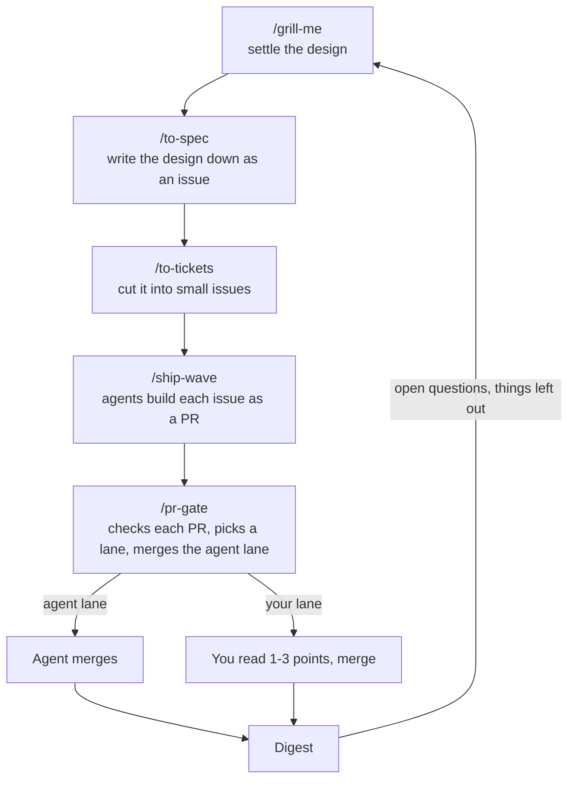

# ship-wave

**Settle the design. Agents ship the PRs. You read one to three lines per PR, not the diff.**

ship-wave is three skills for Claude Code. You agree on a design in one conversation. Agents cut it into small issues, build each one as its own PR in parallel, and a gate merges the safe ones itself. The rest come to you with the exact lines where a person has to decide something.

## Why

- Agents write PRs faster than you can review them. Reading every diff gives back the time they saved.
- Merging without reading is how a bad migration or an auth hole ships.
- Most PRs don't need you. The ones that do need one or two decisions from you, not 400 lines of reading.

ship-wave sorts every PR into one of two lanes. In the agent lane, the gate merges once the checks are green and the review has nothing blocking. In your lane, you get the decision spelled out and a link to the lines. You choose per repo what goes where.

## What you see

A gate comment on a PR in your lane. This one is a made-up example from a shop app:

> **Lane: person's** (repo setting `mvp`, head 3f9c2e1)
>
> **Why:** changes how refunds are paid back, and `src/billing/**` is a sensitive path, so it goes to you.
>
> **Checks:** GitHub checks green; `pnpm test` 214 passed; `pnpm lint` clean.
>
> **Reviews:** two fresh-context reviewers. 1 blocking (a refund could be larger than the original charge), fixed with a test. Second reviewer: no findings.
>
> **Misses:** nothing runs against the live payment provider; the sandbox stands in for it.
>
> **Revert:** revert the squash commit.
>
> **Look at:** `src/billing/refunds.ts` L41-L48. A refund larger than the charge is now rejected, not capped at the charge. Is that the rule you want?

At the end of a wave you get one digest, and it's the only thing you have to read:

> **Your lane**
> - #212 Refunds: reject or cap a refund over the charge? (gate comment, refunds.ts L41)
>
> **Merged by the agent**
> - #208 Order list paging · #209 Order detail page · #210 Empty order list text · #211 Order list tests
>
> **Left out:** #209's issue mentions CSV export, but its criteria don't. Your call whether it becomes an issue.
>
> **Recurring:** two PRs left `console.log` calls in. Proposed as the ESLint `no-console` rule, not a note to the agents.

## Before you use it

- **It runs in Claude Code, on GitHub.** The gate uses the GitHub CLI. The tracker can be Linear, GitHub Issues, Jira or a plain list.
- **It doesn't design for you.** The flow starts once you can say what a user will be able to do and how a test would prove it.
- **The default is careful.** With `lane: live`, only docs and tests merge on their own. Switch a repo to `lane: mvp` and ordinary code merges too, while sensitive paths still come to you.
- **The lanes are rules the agent follows.** Branch protection that requires CI to pass is what makes them hard to get around. On a private repo on GitHub Free, there is none.

## How it fits with other skills

- **[Matt Pocock's skills](https://github.com/mattpocock/skills)** cover the start: the design interview, the spec and the tickets. ship-wave uses them as its first three steps.
- **[Addy Osmani's agent-skills](https://github.com/addyosmani/agent-skills)** teach one agent how to do each engineering step well: spec, test, review, ship. ship-wave answers a different question: how many agents work at once, and which PRs need a person at all.

## Install

This repo holds three skills, `ship-wave`, `pr-gate` and `risk-paths`. Each is a folder with a `SKILL.md`. Copy them to where you want them:

- `~/.claude/skills/` to have them in every project
- `<repo>/.claude/skills/` to have them in one repo

The rest of the flow is Matt Pocock's skills, installed as a plugin that updates itself:

```
claude plugin install mattpocock-skills@claude-plugins-official
```

`pr-gate` needs the GitHub CLI (`gh`). `ship-wave` needs `pr-gate` next to it and the `pr` skill from Matt's plugin; if the engineering plugin is installed, it also uses its `debug` and `deploy-checklist` skills. Then run two things once in each repo: `/setup-matt-pocock-skills`, which asks which tracker you use, and `/risk-paths`, which asks which paths are sensitive and writes the file the gate reads. The other skills read both.

The gate sends back any PR over about 200 hand-written lines or 8 files. To set another cap, put one line in the repo's `CLAUDE.md`, for example `Slice cap: 300 lines, 10 files.` `to-tickets`, `ship-wave` and `pr-gate` all read it.

## How a piece of work flows



> **Before the first wave, run two things once in each repo:**
> 1. `/setup-matt-pocock-skills` to say which tracker you use.
> 2. `/risk-paths` to say which paths are sensitive. Without it the gate sends everything but docs and tests to you.

**1. Settle the design with `/grill-me`.** It interviews you about what you want to build until the open questions are gone. Stop when you can say what a user will be able to do afterwards and how a test would prove it. `/grill-with-docs` does the same and also writes decision records and a glossary.

**2. Write it down with `/to-spec`.** It turns the conversation into a spec issue on your tracker, with no further interview. Every later agent works from issues, not from this chat, so the design has to leave the chat.

**3. Cut it into issues with `/to-tickets`.** Each issue is a sub-issue of the spec and one vertical slice: a small change that works end to end, not "the database part" and then "the UI part". Issues say which other issues they block. In a brand new repo the first issue is a walking skeleton, the smallest thing that builds, runs one path and passes CI.

**4. Run `/ship-wave` with the issue ids.** One agent per issue, each in its own git worktree, each producing a draft PR. On code with no tests, the agent writes a test that pins the current behaviour before changing anything. Ship-wave keeps the tracker up to date, merges in dependency order, and never has more than three PRs waiting on you at once. When it's done you get one digest: what merged, what's open, what needs you, and anything that got left out.

**5. Every PR goes through `/pr-gate`.** Ship-wave runs this itself. The gate sends back a PR that isn't one slice, collects the evidence (check results, screenshots of changed screens), and runs a fresh-context review that reports only bugs, missed criteria and security holes. Then it picks a lane:

- **Agent lane:** the gate merges, and rebases anything stacked on top.
- **Your lane:** you merge. The gate posts one to three "look here" comments on the lines where a human has to decide something, and says in plain words why the PR is in your lane.

Which PRs land in which lane is set per repo in `.claude/risk-paths.md`:

| Setting | Agent merges | You merge |
|---|---|---|
| `lane: live` (default) | docs, tests, regenerated files | everything else |
| `lane: mvp` | everything except sensitive paths and one-way doors | sensitive paths (sign-in, user data, CI, migrations, dependency files, and whatever else you list), one-way doors |

Sensitive paths get a second reviewer with a security lens. If the repo has no `risk-paths.md`, the gate uses the default list in `skills/pr-gate/references/risk-paths-template.md`.

### Writing `.claude/risk-paths.md`

The file has one `lane:` line and up to three sections. Paths are globs, one per bullet, in backticks. A note after ` - ` is for humans and is ignored by the gate.

```markdown
# Risk paths (read by the pr-gate skill)

lane: mvp

## sensitive
- `src/auth/**` - sign-in, sessions, permissions
- `src/billing/**` - anything that charges a card
- `migrations/**` - stored data shape
- `.github/workflows/**` - CI itself
- `package.json`
- `pnpm-lock.yaml`
- `.claude/**` - the rules agents follow, including this file

## needs-adr
- `migrations/**`
- `openapi.yaml`

## docs and tests
- `docs/**`
- `**/*.md`
- `tests/**`
- `**/*.test.*`
```

What each section does:

- **`lane:`** is `mvp` while nobody real is using the product and `live` once they are. Leaving the line out means `live`.
- **`sensitive`** lists the paths where a mistake hurts: sign-in, user data, money, CI, deploy, dependency manifests and lockfiles, and the agent rule files. A PR touching any of them goes to your lane and gets the second reviewer. A file here is sensitive even if it also matches a docs-and-tests glob.
- **`needs-adr`** lists paths whose change needs a decision record. A PR that touches one without a `docs/adr/*.md` file goes to your lane and the gate asks for the ADR.
- **`docs and tests`** lists what counts as a docs-or-tests-only change. A PR is in that bucket only when every changed file matches here and nothing behaves differently.

`/risk-paths` writes it with you: it asks for the lane, finds the candidate paths in the repo, asks what is missing and opens the file as its own PR. Or copy the template by hand and replace the example globs under `sensitive` with your repo's real paths. Until the file exists the gate uses the template with `lane: live`, so nothing but docs and tests merges without you.

**6. Read the digest and the "look here" comments in your lane.** The look-here points are the decisions. The gate comment's evidence section says what was run and what was seen.

Run `/pr-gate` on its own only for a PR that didn't come from a wave: one you wrote by hand, or one from another tool.

## The skills in this repo

| Skill | What it does |
|---|---|
| `ship-wave` | Leads a batch of issues to merged PRs. One sub-agent per issue, draft PRs, pr-gate on each in dependency order, tracker updates, one digest at the end. |
| `pr-gate` | Verifies a PR, picks its lane and merges the agent lane. Collects evidence, runs the review, labels the PR, posts one gate comment and the look-here points, rebases what's stacked on a merged PR. |
| `risk-paths` | Writes `.claude/risk-paths.md` with you, once per repo: the lane and the sensitive paths the gate reads. |

## Skills from Matt Pocock's plugin

Not in this repo. They come from [mattpocock/skills](https://github.com/mattpocock/skills) via the plugin above; see [CREDITS.md](CREDITS.md). The ones the flow uses:

| Skill | Use it for |
|---|---|
| `grill-me` | Being interviewed about a plan until it's settled. |
| `grill-with-docs` | Same, plus decision records (ADRs) and a glossary. |
| `to-spec` | Writing the settled design down as a spec issue, no interview. |
| `to-tickets` | Cutting a spec into issues for `ship-wave`. |
| `prototype` | A throwaway prototype to settle a UI or state question. |
| `improve-codebase-architecture` | Finding the worst tangles in a messy codebase. |
| `wayfinder` | Work too big for one session, laid out as a map of decision tickets. |
| `setup-matt-pocock-skills` | The one-time setup per repo: tracker and labels. |

`grilling`, `domain-modeling`, `codebase-design`, `research` and `pr` (the PR body template `ship-wave` uses) are helpers the skills above call. You don't run them yourself.

## Using the skills on claude.ai

Zip a skill folder (the folder itself at the zip root, no `__pycache__`), then upload it under Customize > Skills. To update one later: the skill > More options > Replace.

Matt's skills have to be zipped from [his repo](https://github.com/mattpocock/skills). They carry a `disable-model-invocation` line in their `SKILL.md`; remove it before uploading. claude.ai only accepts `name`, `description`, `license`, `compatibility`, `metadata` and `allowed-tools`.

## License

MIT, see [LICENSE](LICENSE). Matt Pocock's skills are his, under their own MIT license; see [CREDITS.md](CREDITS.md).
