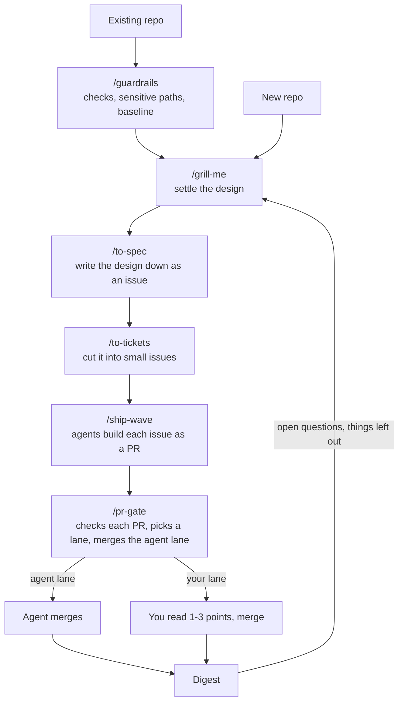

# Agent skills

Skills for Claude Code that take a piece of work from "we agree on the design" to "the PRs are merged", with you reading as little as possible along the way.

The idea: you settle the design in a conversation, an agent cuts it into small issues, a team of agents builds each one as a PR, and a gate decides which PRs an agent can merge on its own and which ones need you. For the ones that need you, the gate tells you the one to three places where a human judgement is required. You don't read diffs.

## Install

Each skill is a folder with a `SKILL.md`. Copy a folder to where you want it:

- `~/.claude/skills/` to have it in every project
- `<repo>/.claude/skills/` to have it in one repo

`ship-wave` needs `pr-gate` and `pr` next to it, and `pr-gate` needs the GitHub CLI (`gh`). If the engineering plugin is installed, `ship-wave` also uses its `debug` and `deploy-checklist` skills. Then run `/setup-matt-pocock-skills` once in each repo. It asks which tracker you use, and the other skills read that.

The gate sends back any PR over about 200 hand-written lines or 8 files. To set another cap, put one line in the repo's `CLAUDE.md`, for example `Slice cap: 300 lines, 10 files.` `to-tickets`, `ship-wave` and `pr-gate` all read it.

## How a piece of work flows



**1. Settle the design with `/grill-me`.** It interviews you about what you want to build until the open questions are gone. Stop when you can say what a user will be able to do afterwards and how a test would prove it. `/grill-with-docs` does the same and also writes decision records and a glossary.

**2. Write it down with `/to-spec`.** It turns the conversation into a spec issue on your tracker, with no further interview. Every later agent works from issues, not from this chat, so the design has to leave the chat.

**3. Cut it into issues with `/to-tickets`.** Each issue is a sub-issue of the spec and one vertical slice: a small change that works end to end, not "the database part" and then "the UI part". Issues say which other issues they block. In a brand new repo the first issue is a walking skeleton, the smallest thing that builds, runs one path and passes CI.

**4. Run `/ship-wave` with the issue ids.** One agent per issue, each in its own git worktree, each producing a draft PR. On code with no tests, the agent writes a test that pins the current behaviour before changing anything. Ship-wave keeps the tracker up to date, merges in dependency order, and never has more than three PRs waiting on you at once. When it's done you get one digest: what merged, what's open, what needs you, and anything that got left out.

**5. Every PR goes through `/pr-gate`.** Ship-wave runs this itself. The gate sends back a PR that isn't one slice, collects the evidence (check results, screenshots of changed screens), and runs a fresh-context review that reports only bugs, missed criteria and security holes. Then it picks a lane:

- **Agent lane:** the gate merges, and rebases anything stacked on top.
- **Your lane:** you merge. The gate posts one to three "look here" comments on the lines where a human has to decide something, and says in plain words why the PR is in your lane.

Which PRs land in which lane is set per repo in `.claude/risk-paths.md`:

| Setting | Agent merges | You merge |
|---|---|---|
| `lane: live` (default) | docs, tests, regenerated files | everything else |
| `lane: mvp` | everything except sensitive paths and one-way doors | sensitive paths (sign-in, user data, CI, migrations, dependency files, and whatever else you list), one-way doors |

Sensitive paths get a second reviewer with a security lens. If the repo has no `risk-paths.md`, the gate uses the default list in `skills/pr-gate/references/risk-paths-template.md`.

### Writing `.claude/risk-paths.md`

The file has one `lane:` line and up to three sections. Paths are globs, one per bullet, in backticks. A note after ` - ` is for humans and is ignored by the gate.

```markdown
# Risk paths (read by the pr-gate skill)

lane: mvp

## sensitive
- `src/auth/**` - sign-in, sessions, permissions
- `src/billing/**` - anything that charges a card
- `migrations/**` - stored data shape
- `.github/workflows/**` - CI itself
- `package.json`
- `pnpm-lock.yaml`
- `.claude/**` - the rules agents follow, including this file

## needs-adr
- `migrations/**`
- `openapi.yaml`

## docs and tests
- `docs/**`
- `**/*.md`
- `tests/**`
- `**/*.test.*`
```

What each section does:

- **`lane:`** is `mvp` while nobody real is using the product and `live` once they are. Leaving the line out means `live`.
- **`sensitive`** lists the paths where a mistake hurts: sign-in, user data, money, CI, deploy, dependency manifests and lockfiles, and the agent rule files. A PR touching any of them goes to your lane and gets the second reviewer. A file here is sensitive even if it also matches a docs-and-tests glob.
- **`needs-adr`** lists paths whose change needs a decision record. A PR that touches one without a `docs/adr/*.md` file goes to your lane and the gate asks for the ADR.
- **`docs and tests`** lists what counts as a docs-or-tests-only change. A PR is in that bucket only when every changed file matches here and nothing behaves differently.

Start by copying the template and replacing the example globs under `sensitive` with your repo's real paths. If you use [agent-guardrails](https://github.com/freshmick/agent-guardrails), `/guardrails` writes a first version for you.

**6. Read the digest and the "look here" comments in your lane.** The look-here points are the decisions. The gate comment's evidence section says what was run and what was seen.

Run `/pr-gate` on its own only for a PR that didn't come from a wave: one you wrote by hand, or one from another tool.

## The skills in this repo

| Skill | What it does |
|---|---|
| `ship-wave` | Leads a batch of issues to merged PRs. One sub-agent per issue, draft PRs, pr-gate on each in dependency order, tracker updates, one digest at the end. |
| `pr-gate` | Verifies a PR, picks its lane and merges the agent lane. Collects evidence, runs the review, labels the PR, posts one gate comment and the look-here points, rebases what's stacked on a merged PR. |

## Skills from Matt Pocock

Copied unchanged from [mattpocock/skills](https://github.com/mattpocock/skills) under MIT. See [CREDITS.md](CREDITS.md).

| Skill | Use it for |
|---|---|
| `grill-me` | Being interviewed about a plan until it's settled. |
| `grill-with-docs` | Same, plus decision records (ADRs) and a glossary. |
| `to-spec` | Writing the settled design down as a spec issue, no interview. |
| `to-tickets` | Cutting a spec into issues for `ship-wave`. |
| `prototype` | A throwaway prototype to settle a UI or state question. |
| `improve-codebase-architecture` | Finding the worst tangles in a messy codebase. |
| `wayfinder` | Work too big for one session, laid out as a map of decision tickets. |
| `setup-matt-pocock-skills` | The one-time setup per repo: tracker and labels. |

`grilling`, `domain-modeling`, `codebase-design`, `research` and `pr` (the PR body template `ship-wave` uses) are helpers the skills above call. You don't run them yourself.

## Related

**Existing repo?** Run [`/guardrails`](https://github.com/freshmick/agent-guardrails) before anything else: the gate's sensitive paths come from it. It sets up checks, the sensitive-paths list and a baseline so agents don't change code in a repo with no safety net. In a new repo, run it once the walking skeleton has merged.

## Using the skills on claude.ai

Zip a skill folder (the folder itself at the zip root, no `__pycache__`), then upload it under Customize > Skills. To update one later: the skill > More options > Replace.

Matt's skills carry a `disable-model-invocation` line in their `SKILL.md`. Remove it before uploading. claude.ai only accepts `name`, `description`, `license`, `compatibility`, `metadata` and `allowed-tools`.
